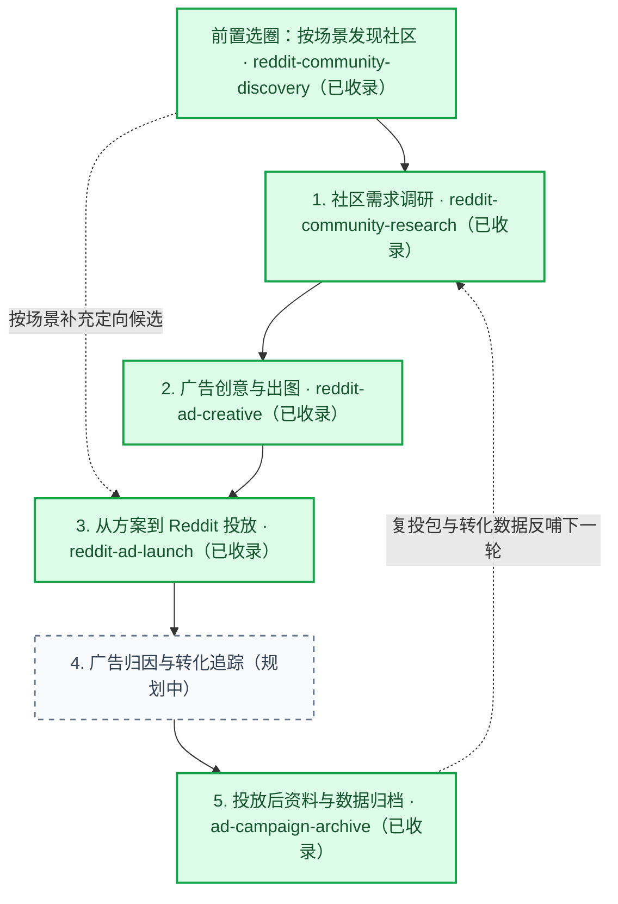
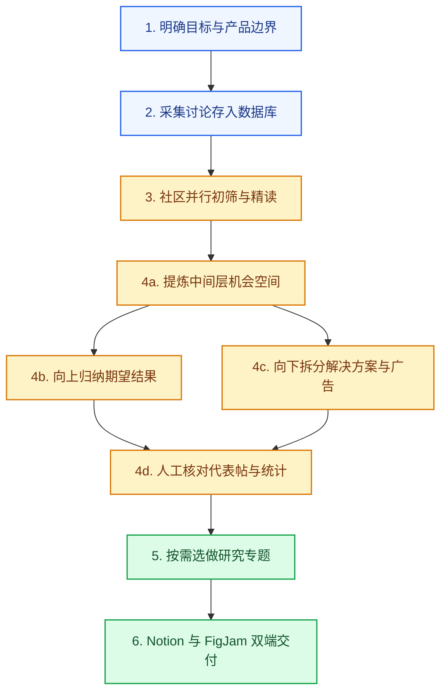
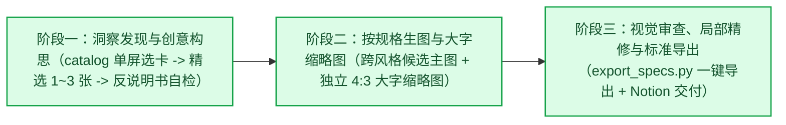
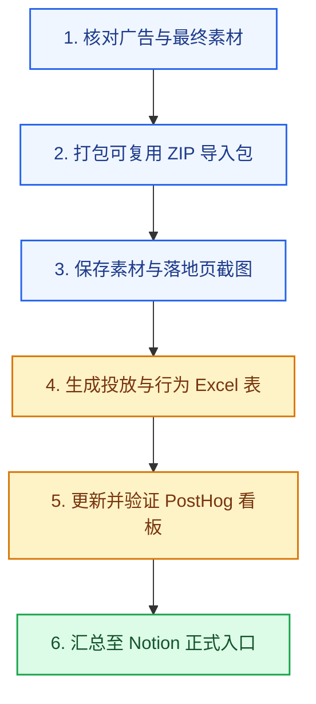

# Reddit 广告全流程 Agent Skills

本仓库存放面向 Reddit 广告投放全流程的 AI Agent Skills（智能体技能）。整套工作流由六个前后衔接的技能组成，覆盖按场景发现合理目标社区、社区真实需求调研、具体广告方案制定、平台投放执行、跨平台转化归因，以及投放结束后的素材包与数据看板归档。

## 全流程阶段概览



| 阶段 | 技能 | 状态 | 主要产出 |
| --- | --- | --- | --- |
| 前置选圈 | [`reddit-community-discovery`](skills/reddit-community-discovery/SKILL.md) | 已收录 | 视角互补的合理目标社区清单、真实场景代表帖直达链接、下游一键采集命令 |
| 第一阶段 | [`reddit-community-research`](skills/reddit-community-research/SKILL.md) | 已收录 | SQLite 原始资料库、逐帖需求记录、Notion 调研报告、FigJam 机会空间白板 |
| 第二阶段 | [`reddit-ad-creative`](skills/reddit-ad-creative/SKILL.md) | 已收录 | Reddit 信息流主图（`4:5` / `4:3` / `1:1`）、独立重绘的 `4:3`（`400×300`）大字版缩略图、同步至 Notion 的成品与心理学拆解文档 |
| 第三阶段 | [`reddit-ad-launch`](skills/reddit-ad-launch/SKILL.md) | 已收录 | 当前账户模板的导入表与素材包、逐条广告追踪链接、上线检查与实际状态记录 |
| 第四阶段 | 广告归因与转化追踪技能 | 规划中 | 归因审计报告、首次广告到站归属规则、注册与核心行为转化漏斗 |
| 第五阶段 | [`ad-campaign-archive`](skills/ad-campaign-archive/SKILL.md) | 已收录 | 可复用广告导入 ZIP 包、落地页截图存档、多工作表 Excel、PostHog 看板、Notion 汇总页 |

---

## 各阶段技能详解

### 0. 按场景发现合理的 Reddit 社区（`reddit-community-discovery`，已收录）

**核心职责**：在尚未确定具体研究或投放哪些 subreddit 时，从业务场景、产品方向或用户痛点出发，找出**真实讨论该场景、视角互补的合理社区组合**，解决“先去哪些社区找人”的问题。


- **拆解日常搜帖线索**：把抽象业务词转化为目标用户在帖子里实际会写的具体任务动作、求助原话、现有替代工具与人群角色。
- **双路挖掘候选社区**：一边搜真实场景帖看讨论落在哪里并收集发帖作者，一边通过 Arctic Shift 作者互动接口（`/users/interactions/subreddits`）与社区侧边栏友链提取，找出多位目标作者近期共同活跃的社区及版主整理的姊妹社区。
- **抽样核实日常讨论**：拉取候选社区简介、实时订阅人数与近期帖子标题和摘要，确认社区日常讨论贴合目标场景，最终组合核心品类圈、工作流工具圈、人群身份圈与上下游邻近圈交付下游采集。

#### 配套命令行工具

`skills/reddit-community-discovery/scripts/community_discovery.py` 提供作者跨社区共同活跃拓展与候选社区近期真帖速览功能（基于 Python 标准库）：

```bash
# 顺着已知种子社区或聊过目标场景的真实作者，发现多位目标用户共同活跃的关联社区
python3 skills/reddit-community-discovery/scripts/community_discovery.py expand \
  --seed-subreddit <种子社区> \
  --author <作者名> \
  --prefix <词根前缀>

# 快速查看候选社区的简介、实时订阅人数与近期真实帖子
python3 skills/reddit-community-discovery/scripts/community_discovery.py peek \
  --subreddit <候选社区>
```

---

### 1. 社区需求调研与机会空间构建（`reddit-community-research`，已收录）

**核心职责**：放在整个广告流程的第一步，采集并精读 Reddit 社区的真实帖子与评论，提取带发生条件的具体需求，构建机会空间树（Outcome Space 期望结果空间 $\rightarrow$ 机会空间 $\rightarrow$ 解决方案 $\rightarrow$ 广告方向），解决“向谁投、讲什么痛点、给什么产品承诺”的问题。

#### 执行流程图



#### 六个步骤说明

1. **确认研究目标与产品边界**：明确要研究的产品、目标人群和需要回答的问题；提前核清我方产品已经具备的真实能力，保证后续推导出的广告承诺都能兑现。
2. **采集与管理原始社区讨论**：通过配套脚本从 Arctic Shift（Reddit 历史公共归档接口）或已有导出文件采集一个或多个指定社区与时间范围的帖子和评论，保存在本地 SQLite 数据库中，保留回复层级、身份标签（`author_flair`）、赞同率与争议标记，并按编号去重。
3. **按社区并行初筛与精读**：每个目标社区分配独立分析任务，逐帖阅读正文与评论链，用大白话写清用户在什么场景下遇到了什么困难、想要什么结果，标记问题归属（目标平台自身问题、迁移摩擦、上下游工具问题等）与真实行动三档等级（`acted` 已行动、`seeking` 寻找方案、`expressing` 仅表达感受，附同作者原话证据）。
4. **构建机会空间树并人工核对**：
   - 从中间层的**机会空间**出发：合并发生在同一业务环节、直指同一具体障碍的需求，标题用日常白话直说用户想减少什么阻碍或办成什么事，并统计去重后的独立讨论数、账号数、评论数、真实行动等级分布、高争议主帖数及分社区统计（`by_subreddit`）。
   - 向上归纳 **Outcome Space（期望结果空间）**：提炼用户在业务上追求的顶层结果。
   - 向下推导**解决方案与广告方向**：结合买方视角竞争定位（April Dunford Positioning：竞争参照系、独特属性、用户价值、最在意的细分人群、市场类别），按用户的真实购买理由拆分独立的广告卡片，写出目标人群、重点投放社区、痛点钩子、可验证的产品承诺和画面方向。
   - 逐项人工核对代表帖原话，确保代表帖直指该分支痛点，且用户的事实经历与主观猜测分开呈现。
5. **按需增补研究专题**：针对未回答的问题，选用社区对比选择、主要用户画像、API 平台评价、模型评价、用户旅程或 Kano 需求分类专题。
6. **Notion 与 FigJam 双端同步交付**：将完整报告与分社区、分行动等级统计写入 Notion，并在 FigJam 中用规范色卡绘制简明四层机会空间树，两边的一、二级编号、标题、核心讨论数与代表帖一一对应。

#### 配套命令行工具

`skills/reddit-community-research/scripts/reddit_research.py` 提供确定性的数据采集、分批与去重统计功能（基于 Python 3.10+ 标准库）：

```bash
# 1. 按时间范围采集一个或多个指定社区的帖子与评论
python3 skills/reddit-community-research/scripts/reddit_research.py collect \
  --db /path/to/research.sqlite \
  --subreddit openrouter \
  --subreddit LocalLLaMA \
  --after 2026-09-15 \
  --before 2026-09-16

# 2. 查看数据库覆盖情况与缺失父级
python3 skills/reddit-community-research/scripts/reddit_research.py status \
  --db /path/to/research.sqlite

# 3. 生成初筛批次并合并筛选结果
python3 skills/reddit-community-research/scripts/reddit_research.py batches \
  --db /path/to/research.sqlite \
  --out /path/to/screen-batches

python3 skills/reddit-community-research/scripts/reddit_research.py selected \
  --db /path/to/research.sqlite \
  --screen /path/to/screen.jsonl \
  --batches /path/to/screen-batches \
  --out /path/to/selected.json

# 4. 读取单条完整讨论树
python3 skills/reddit-community-research/scripts/reddit_research.py thread \
  --db /path/to/research.sqlite \
  --post-id t3_example \
  --out /path/to/thread.json

# 5. 校验行动证据，按机会空间去重统计讨论数、真实行动分布与分社区分布
python3 skills/reddit-community-research/scripts/reddit_research.py count \
  --db /path/to/research.sqlite \
  --findings /path/to/findings.jsonl \
  --scope target_platform,competitor_pitch_opportunity \
  --out /path/to/counts.json
```

---

### 2. 广告创意构思、按规格生图与无损精修（`reddit-ad-creative`，已收录）

**核心职责**：承接第一阶段产出的机会空间树与痛点证据，调用内置的**深层心理学与视觉修辞卡片库**（涵盖抓心心理机制、视觉叙事与构图技巧、标题与文案修辞、切入定位与说服技巧四大维度），通过三阶段工作流产出结构化广告创意简报、Reddit 信息流主图与独立重绘的 `4:3` 超大字缩略图。



- **阶段一（洞察发现与创意构思）**：运行 `ad_playbook.py catalog` 单屏浏览全部卡片的名称与适用场景（`when_to_use`），每个方向仅精选 1～3 张最契合的核心卡并运行 `show` 精读，完成「反说明书自检」（确保画面提供文字之外的情绪现场、人物神态、荒诞反差或排印张力，拒绝把文案画成流程图或贴签道具）。
- **阶段二（按规格生图与制作大字缩略图）**：按内容形态选定 Reddit 信息流主图比例（默认官方推荐 `4:5` 竖图 `1080×1350`，或 `4:3` 横图 `1440×1080`、`1:1` 方图 `1080×1080`），预留安全呼吸边距并生成风格跨度鲜明的候选主图；同时针对紧凑视图专门生成放大单焦点特写的 `4:3`（`400 × 300 px`，$\le 500\text{ KB}$）超大字缩略图。
- **阶段三（视觉质量审查、无损精修与标准导出）**：内部对照【原则表 A】与【原则表 B】核对并按需局部修补，通过 `export_specs.py` 一键导出精确尺寸 PNG，将最终图片、配套外标题与心理学创作拆解同步写入 Notion。

#### 配套命令行工具

`skills/reddit-ad-creative/scripts/` 提供卡片检索脚本 `ad_playbook.py` 与标准规格导出脚本 `export_specs.py`：

```bash
# 1. 单屏列出 56 张心理学、视觉构图、文案修辞与说服卡片的名称及适用场景
python3 skills/reddit-ad-creative/scripts/ad_playbook.py catalog

# 2. 按卡片 ID 展开精选卡片（单次最多 6 张；每个方向挑 1~3 张核心卡即可）
python3 skills/reddit-ad-creative/scripts/ad_playbook.py show \
  psych_01_pain_reenactment \
  vis_carrier_03_human_reaction_moment

# 3. 将原始生图导出为精确 Reddit 官方尺寸 PNG（feed-4x5 / feed-4x3 / feed-1x1 / thumb-4x3）
python3 skills/reddit-ad-creative/scripts/export_specs.py raw.jpg final_1080x1350.png --preset feed-4x5
```

---

### 3. 从方案到 Reddit 投放（`reddit-ad-launch`，已收录）

**核心职责**：承接第二阶段的创意与素材，准备社区和关键词候选，与用户确定投放类型、受众、预算和排期，生成追踪链接与导入文件，并按授权完成 Reddit Ads（Reddit 广告后台）的保存、启用与结果核对。


- **当前模板与层级配置**：分别处理新建、添加创意和更新已有对象，正确使用平台编号与临时引用，按实际预算对象核算花费。
- **投放建议与用户选择**：读取现有社区和关键词，提出有依据的候选与分组，明确列出新增内容、预算合计和具体排期，确认尚未确定的选择。
- **逐条广告追踪**：沿用项目 UTM（来源追踪参数）命名，保存广告、素材、落地链接及真实平台编号的对应关系，交给后续归因环节使用。
- **导入包与上线核对**：复用 `ad-campaign-archive` 的素材打包工具，核对当前规格、实际页面和优化事件；上传方式由当前后台决定。
- **按授权执行与核实**：区分文件完成、后台保存和启用投放，执行后重新读取实际配置与平台状态。

---

### 4. 广告归因与转化追踪技能（规划中）

**核心职责**：在广告投放期间与结算阶段，打通 Reddit 广告平台曝光点击数据与站内产品分析工具（如 PostHog）的访客转化数据，统一跨平台统计口径。


- **跨平台数据对照**：对照 Reddit 广告后台的曝光、点击、花费数据与站内采集到的实际访问事件。
- **核对归属与身份合并**：核对首次广告到站归属规则、观察窗口天数以及匿名访客到注册用户的身份合并逻辑。
- **输出注册与激活漏斗**：排查链接参数丢失、重复计数或跨平台统计口径不一致的问题，输出准确的注册与激活漏斗。

---

### 5. 投放后资料与数据归档（`ad-campaign-archive`，已收录）

**核心职责**：在单批广告投放完成之后，把散落在广告后台、本地目录、聊天会话和 PostHog 分析看板里的资料整理成一套标准档案，统一汇总到 Notion 正式入口，方便团队复盘并在下一批投放时直接复用。

#### 执行流程图



#### 六个步骤说明

1. **确认本批广告与最终素材**：以广告平台实际投放记录为准，核对每条广告的广告系列、广告组、广告编号、标题、主图、缩略图和带 UTM 参数的落地链接，区分最终上线版本与过程草稿。
2. **制作可复用的 Reddit 导入包**：导出或生成符合当前账户模板的 CSV 文件（复投模板默认设为 `PAUSED` 暂停状态，保留受众与关键词配置），将 CSV 与实际引用的主图、缩略图平铺打包为单个 ZIP 文件。
3. **保存投放素材与落地页存档**：建立“一条广告一行”的对照表，保存缩略图预览、原图文件、Reddit 帖子详情链接、带完整 UTM 参数的落地链接，以及标注了抓取日期的落地页完整长截图。
4. **整理投放数据与用户行为表**：合并广告平台指标（曝光、点击、CTR 点击率、CPC 单次点击费用、总花费）与 PostHog 站内转化指标（到站人数、注册人数、创建 API 密钥人数、首次成功调用人数等），生成包含投放汇总、逐位访客、逐页停留与滚动明细、注册用户完整路径的多工作表 Excel 文件。
5. **更新并核对 PostHog 看板**：配置包含核心指标卡、各广告表现对比表、分广告转化漏斗和注册后留存行为的主看板，验证日期范围与广告筛选器正常工作。
6. **汇总到 Notion 正式入口**：将复投导入包、Excel 数据表、素材与落地页表、看板链接和原始制作会话统一写入目标 Notion 页面，并在旧页面或草稿页留下正式入口链接。

#### 配套命令行工具

`skills/ad-campaign-archive/scripts/package_assets.py` 用于检查 CSV 中引用的主图与缩略图文件是否存在、文件名是否合法，并将 CSV 与所有引用素材平铺打包为单个 ZIP 文件（基于 Python 3.10+ 标准库）：

```bash
python3 skills/ad-campaign-archive/scripts/package_assets.py \
  --csv /path/to/campaign_import.csv \
  --assets-dir /path/to/final_assets \
  --output /path/to/campaign_reusable_bundle.zip
```

---

## 仓库目录结构

| 路径 | 说明 |
| --- | --- |
| [`skills/reddit-community-discovery/SKILL.md`](skills/reddit-community-discovery/SKILL.md) | 前置选圈：按业务场景发现合理目标社区组合的技能主指令 |
| [`skills/reddit-community-discovery/scripts/community_discovery.py`](skills/reddit-community-discovery/scripts/community_discovery.py) | 目标作者跨社区共同活跃图谱扩展（`expand`）与候选社区近期真帖速览（`peek`）脚本 |
| [`skills/reddit-community-discovery/tests/`](skills/reddit-community-discovery/tests) | `community_discovery.py` 的单元测试 |
| [`skills/reddit-community-research/SKILL.md`](skills/reddit-community-research/SKILL.md) | 第一阶段：Reddit 社区需求调研与机会空间构建技能主指令 |
| [`skills/reddit-community-research/references/`](skills/reddit-community-research/references) | 采集工具说明、需求提取规则、机会空间树分类规则、定位与广告卡片写法、选做专题与双端交付规范 |
| [`skills/reddit-community-research/scripts/reddit_research.py`](skills/reddit-community-research/scripts/reddit_research.py) | Reddit 历史数据采集、SQLite 存储、初筛分批、讨论树读取与去重统计脚本 |
| [`skills/reddit-community-research/tests/`](skills/reddit-community-research/tests) | `reddit_research.py` 的单元测试与测试样例数据 |
| [`skills/reddit-ad-creative/SKILL.md`](skills/reddit-ad-creative/SKILL.md) | 第二阶段：Reddit 广告创意构思、按规格生图与无损精修技能主指令 |
| [`skills/reddit-ad-creative/library/`](skills/reddit-ad-creative/library) | 4 大 JSON 理论卡片库（涵盖心理机制、视觉模板、标题修辞与说服技巧） |
| [`skills/reddit-ad-creative/references/`](skills/reddit-ad-creative/references) | 阶段一构思指南、阶段二 Reddit 规格与生图提示词规范、阶段三视觉质量审查与局部无损精修指南 |
| [`skills/reddit-ad-creative/scripts/ad_playbook.py`](skills/reddit-ad-creative/scripts/ad_playbook.py) | 理论卡片单屏目录检索与精选卡片详情展开脚本 |
| [`skills/reddit-ad-creative/scripts/export_specs.py`](skills/reddit-ad-creative/scripts/export_specs.py) | Reddit 官方主图（`4:5` / `4:3` / `1:1`）与缩略图（`400×300`）标准规格导出脚本 |
| [`skills/reddit-ad-creative/tests/`](skills/reddit-ad-creative/tests) | `ad_playbook.py`、`export_specs.py` 与 4 大卡片库完整性的自动化测试 |
| [`skills/reddit-ad-launch/SKILL.md`](skills/reddit-ad-launch/SKILL.md) | 第三阶段：从已确认方案与素材到 Reddit 投放的技能主指令 |
| [`skills/reddit-ad-launch/references/`](skills/reddit-ad-launch/references) | 投放建议、七类设置的逐项确认清单、批量导入、追踪链接与交接、上线检查；打包工具复用第五阶段 |
| [`skills/ad-campaign-archive/SKILL.md`](skills/ad-campaign-archive/SKILL.md) | 第五阶段：广告投放后资料与数据归档技能主指令 |
| [`skills/ad-campaign-archive/references/`](skills/ad-campaign-archive/references) | 归档交付物清单、Reddit 导入包规范、Excel 与 PostHog 看板口径说明及会话总结依据 |
| [`skills/ad-campaign-archive/scripts/package_assets.py`](skills/ad-campaign-archive/scripts/package_assets.py) | 广告导入 CSV 与图片素材核对及 ZIP 平铺打包脚本 |

---

## 安装与使用

将本仓库克隆到本地后，可通过软链接（Symbolic Link，指向原文件夹的快捷方式）将所需技能挂载到 Claude Code、Codex 或 Antigravity 的技能目录中：

```bash
git clone https://github.com/ezra-y/reddit-ad-workflow-skills.git

# 挂载到全局技能目录（按你使用的工具路径选择）
ln -s "$(pwd)/reddit-ad-workflow-skills/skills/reddit-community-discovery" ~/.claude/skills/reddit-community-discovery
ln -s "$(pwd)/reddit-ad-workflow-skills/skills/reddit-community-research" ~/.claude/skills/reddit-community-research
ln -s "$(pwd)/reddit-ad-workflow-skills/skills/reddit-ad-creative" ~/.claude/skills/reddit-ad-creative
ln -s "$(pwd)/reddit-ad-workflow-skills/skills/reddit-ad-launch" ~/.claude/skills/reddit-ad-launch
ln -s "$(pwd)/reddit-ad-workflow-skills/skills/ad-campaign-archive" ~/.claude/skills/ad-campaign-archive
```

第三阶段的素材打包复用 `ad-campaign-archive`，使用时同时保留该技能。通过 `agents-kit` 管理技能的环境，使用其导入与启用命令统一管理。

运行单元测试验证社区发现、需求调研与创意脚本：

```bash
python3 skills/reddit-community-discovery/tests/test_community_discovery.py
PYTHONPATH=skills/reddit-community-research python3 -m unittest skills/reddit-community-research/tests/test_reddit_research.py
python3 skills/reddit-ad-creative/tests/test_ad_playbook.py
```
