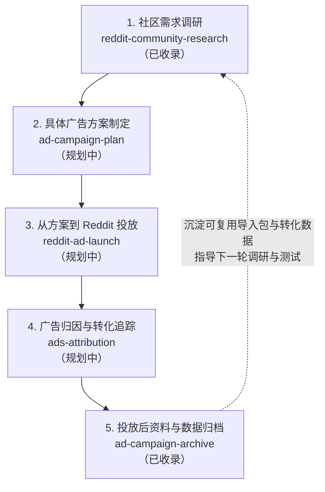

# Reddit 广告全流程 Agent Skills

本仓库存放面向 Reddit 广告投放全流程的 AI Agent Skills（智能体技能）。整套工作流由五个前后衔接的技能组成，覆盖从前期社区真实需求调研、具体广告方案制定、平台投放执行、跨平台转化归因，到投放结束后的素材包与数据看板归档。

## 五阶段整体工作流



| 阶段 | 技能名称 | 当前状态 | 核心职责 | 主要产出 |
| --- | --- | --- | --- | --- |
| 第一阶段 | [`reddit-community-research`](skills/reddit-community-research/SKILL.md) | 已收录 | 采集并精读 Reddit 社区真实帖子与评论，提取带发生条件的具体需求，构建机会空间树（Outcome Space 期望结果空间 $\rightarrow$ 机会空间 $\rightarrow$ 解决方案 $\rightarrow$ 广告方向） | SQLite 原始资料库、逐帖需求记录、Notion 调研报告、FigJam 机会空间白板 |
| 第二阶段 | 调研后的具体广告方案技能 | 规划中 | 基于第一阶段筛出的重点机会空间、买方视角竞争定位与广告方向，制定具体的广告测试假设、受众定向、文案脚本与视觉画面方案 | 结构化广告方案文档、分受众文案与视觉制作清单、实验对照设计 |
| 第三阶段 | 从方案到 Reddit 投放技能 | 规划中 | 将确认后的广告方案转化为 Reddit Ads（Reddit 广告后台）标准配置，完成广告系列（Campaign）、广告组（Ad Group）、创意素材与带 UTM（来源追踪参数）落地链接的批量生成与上线检查 | 平台标准批量导入表、上线前参数与预算核对清单 |
| 第四阶段 | 广告归因与转化追踪技能 | 规划中 | 核对广告平台曝光点击数据与站内分析工具（如 PostHog 产品分析平台）的访客身份、UTM 参数传递、观察窗口及注册激活漏斗，统一跨平台转化统计口径 | 归因审计报告、首次广告到站归属规则、注册与核心行为转化漏斗 |
| 第五阶段 | [`ad-campaign-archive`](skills/ad-campaign-archive/SKILL.md) | 已收录 | 在单批广告投放完成后，整理最终投放素材、可复用 ZIP 导入包、带日期的落地页完整截图、逐广告与逐访客 Excel 数据表以及 PostHog 看板，统一汇总到 Notion 正式入口 | 可直接复用的广告导入 ZIP 包、落地页存档、多工作表 Excel 数据文件、PostHog 看板、Notion 汇总页 |

---

## 各阶段技能详解

### 1. 社区需求调研与机会空间构建（`reddit-community-research`，已收录）

放在整个广告流程的第一步，用于解决“向谁投、讲什么痛点、给什么承诺”的问题。

#### 核心工作内容

1. **确认研究目标与产品边界**：明确要研究的产品、目标人群和需要回答的问题；提前核清我方产品已经具备的真实能力，保证后续推导出的广告承诺都能兑现。
2. **采集与管理原始社区讨论**：通过配套脚本从 Arctic Shift（Reddit 历史公共归档接口）或已有导出文件采集指定时间范围的帖子和评论，保存在本地 SQLite 数据库中，保留回复层级并按编号去重。
3. **按社区并行初筛与精读**：每个目标社区分配独立分析任务，逐帖阅读正文与评论链，用大白话写清用户在什么场景下遇到了什么困难、想要什么结果，并标记问题归属（目标平台自身问题、迁移摩擦、上下游工具问题等）。
4. **构建机会空间树并人工核对**：
   - 从中间层的**机会空间**出发：合并发生在同一业务环节、直指同一具体障碍的需求，标题用日常白话直说用户想减少什么阻碍或办成什么事，并统计去重后的帖子数、评论数和独立作者数。
   - 向上归纳 **Outcome Space（期望结果空间）**：提炼用户在业务上追求的顶层结果。
   - 向下推导**解决方案与广告方向**：结合买方视角竞争定位（April Dunford Positioning：竞争参照系、独特属性、用户价值、最在意的细分人群、市场类别），按用户的真实购买理由拆分独立的广告卡片，写出目标人群、痛点钩子、可验证的产品承诺和画面方向。
   - 逐项人工核对代表帖原话，确保代表帖直指该分支痛点，且用户的事实经历与主观猜测分开呈现。
5. **按需增补研究专题**：针对未回答的问题，选用社区对比选择、主要用户画像、API 平台评价、模型评价、用户旅程或 Kano 需求分类专题。
6. **Notion 与 FigJam 双端同步交付**：将完整报告写入 Notion，并在 FigJam 中用规范色卡绘制四层机会空间树，两边的一、二级编号、标题、统计数字与代表帖完全一致。

#### 配套命令行工具

`skills/reddit-community-research/scripts/reddit_research.py` 提供确定性的数据采集、分批与去重统计功能（基于 Python 3.10+ 标准库）：

```bash
# 1. 按时间范围采集指定社区的帖子与评论
python3 skills/reddit-community-research/scripts/reddit_research.py collect \
  --db /path/to/research.sqlite \
  --subreddit openrouter \
  --after 2026-09-15 \
  --before 2026-09-16

# 2. 查看数据库覆盖情况与缺失父级
python3 skills/reddit-community-research/scripts/reddit_research.py status \
  --db /path/to/research.sqlite

# 3. 生成初筛批次并合并筛选结果
python3 skills/reddit-community-research/scripts/reddit_research.py batches \
  --db /path/to/research.sqlite \
  --out /path/to/screen-batches

python3 skills/reddit-community-research/scripts/reddit_research.py selected \
  --db /path/to/research.sqlite \
  --screen /path/to/screen.jsonl \
  --batches /path/to/screen-batches \
  --out /path/to/selected.json

# 4. 读取单条完整讨论树
python3 skills/reddit-community-research/scripts/reddit_research.py thread \
  --db /path/to/research.sqlite \
  --post-id t3_example \
  --out /path/to/thread.json

# 5. 按机会空间去重统计帖子数、评论数与独立作者数
python3 skills/reddit-community-research/scripts/reddit_research.py count \
  --db /path/to/research.sqlite \
  --findings /path/to/findings.jsonl \
  --scope target_platform,competitor_pitch_opportunity \
  --out /path/to/counts.json
```

---

### 2. 调研后的具体广告方案技能（规划中）

承接第一阶段产出的机会空间树与广告方向卡片，将高优先级的机会转化为可直接生产的广告方案：

- 挑选证据最充足、转化潜力最高的机会空间分支，明确本轮测试的受众社区与人群定向。
- 为每个独立购买理由编写完整的广告标题（Headline）、正文钩子（Body Copy）、行动号召（CTA）以及对应的视觉画面脚本。
- 设计配套落地页的承接首屏文案与转化路径，保证用户点击广告后的页面信息与广告承诺一致。

---

### 3. 从方案到 Reddit 投放技能（规划中）

承接第二阶段确认的广告方案与制作好的视觉素材，完成上线前的平台配置：

- 生成符合 Reddit Ads 后台当前导入模板规范的广告系列、广告组和广告创意配置表。
- 为每条广告配置独立的 UTM 来源追踪参数（`utm_source`、`utm_medium`、`utm_campaign`、`utm_content` 等），支持后续按单条广告追踪效果。
- 核对预算上限、出价策略、投放时段、目标社区与素材文件规格，生成可直接上传后台的投放包。

---

### 4. 广告归因与转化追踪技能（规划中）

在广告投放期间与结算阶段，打通广告平台数据与站内产品行为数据：

- 对照 Reddit 广告后台的曝光、点击、花费数据与站内分析工具（PostHog 等）采集到的访问事件。
- 核对首次广告到站归属规则、观察窗口天数以及匿名访客到注册用户的身份合并逻辑。
- 排查链接参数丢失、重复计数或跨平台统计口径不一致的问题，输出准确的转化漏斗数据。

---

### 5. 投放后资料与数据归档（`ad-campaign-archive`，已收录）

放在单批广告投放完成之后，负责把散落在广告后台、本地目录、聊天会话和分析看板里的资料整理成一套标准档案，方便团队复盘并在下一批投放时直接复用。

#### 核心工作内容

1. **确认本批广告与最终素材**：以广告平台实际投放记录为准，核对每条广告的广告系列、广告组、广告编号、标题、主图、缩略图和带 UTM 参数的落地链接，区分最终上线版本与过程草稿。
2. **制作可复用的 Reddit 导入包**：导出或生成符合当前账户模板的 CSV 文件（复投模板默认设为 `PAUSED` 暂停状态，保留受众与关键词配置），将 CSV 与实际引用的主图、缩略图平铺打包为单个 ZIP 文件。
3. **保存投放素材与落地页存档**：建立“一条广告一行”的对照表，保存缩略图预览、原图文件、Reddit 帖子详情链接、带完整 UTM 参数的落地链接，以及标注了抓取日期的落地页完整长截图。
4. **整理投放数据与用户行为表**：合并广告平台指标（曝光、点击、CTR 点击率、CPC 单次点击费用、总花费）与 PostHog 站内转化指标（到站人数、注册人数、创建 API 密钥人数、首次成功调用人数等），生成包含投放汇总、逐位访客、逐页停留与滚动明细、注册用户完整路径的多工作表 Excel 文件。
5. **更新并核对 PostHog 看板**：配置包含核心指标卡、各广告表现对比表、分广告转化漏斗和注册后留存行为的主看板，验证日期范围与广告筛选器正常工作。
6. **汇总到 Notion 正式入口**：将复投导入包、Excel 数据表、素材与落地页表、看板链接和原始制作会话统一写入目标 Notion 页面，并在旧页面或草稿页留下正式入口链接。

#### 配套命令行工具

`skills/ad-campaign-archive/scripts/package_assets.py` 用于检查 CSV 中引用的主图与缩略图文件是否存在、文件名是否合法，并将 CSV 与所有引用素材平铺打包为单个 ZIP 文件（基于 Python 3.10+ 标准库）：

```bash
python3 skills/ad-campaign-archive/scripts/package_assets.py \
  --csv /path/to/campaign_import.csv \
  --assets-dir /path/to/final_assets \
  --output /path/to/campaign_reusable_bundle.zip
```

---

## 仓库目录结构

| 路径 | 说明 |
| --- | --- |
| [`skills/reddit-community-research/SKILL.md`](skills/reddit-community-research/SKILL.md) | 第一阶段：Reddit 社区需求调研与机会空间构建技能主指令 |
| [`skills/reddit-community-research/references/`](skills/reddit-community-research/references) | 调研技能的采集工具说明、需求提取规则、机会空间树分类规则、定位与广告卡片写法、选做专题与双端交付规范 |
| [`skills/reddit-community-research/scripts/reddit_research.py`](skills/reddit-community-research/scripts/reddit_research.py) | Reddit 历史数据采集、SQLite 存储、初筛分批、讨论树读取与去重统计脚本 |
| [`skills/reddit-community-research/tests/`](skills/reddit-community-research/tests) | `reddit_research.py` 的单元测试与测试样例数据 |
| [`skills/ad-campaign-archive/SKILL.md`](skills/ad-campaign-archive/SKILL.md) | 第五阶段：广告投放后资料与数据归档技能主指令 |
| [`skills/ad-campaign-archive/references/`](skills/ad-campaign-archive/references) | 归档技能的交付物清单、Reddit 导入包规范、Excel 与 PostHog 看板口径说明及会话总结依据 |
| [`skills/ad-campaign-archive/scripts/package_assets.py`](skills/ad-campaign-archive/scripts/package_assets.py) | 广告导入 CSV 与图片素材核对及 ZIP 平铺打包脚本 |

---

## 安装与使用

将本仓库克隆到本地后，可通过软链接（Symbolic Link，指向原文件夹的快捷方式）将所需技能挂载到 Claude Code、Codex 或 Antigravity 的技能目录中：

```bash
git clone https://github.com/ezra-y/reddit-ad-workflow-skills.git

# 挂载到全局技能目录（按你使用的工具路径选择）
ln -s "$(pwd)/reddit-ad-workflow-skills/skills/reddit-community-research" ~/.claude/skills/reddit-community-research
ln -s "$(pwd)/reddit-ad-workflow-skills/skills/ad-campaign-archive" ~/.claude/skills/ad-campaign-archive
```

运行单元测试验证调研脚本：

```bash
PYTHONPATH=skills/reddit-community-research python3 -m unittest skills/reddit-community-research/tests/test_reddit_research.py
```
