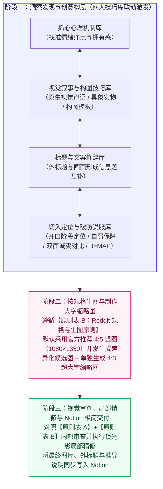

# 第二阶段技能（广告创意与出图）完整架构与理论蓝图

本蓝图将广告心理学机制、视觉叙事规律、修辞格技巧与说服模型提炼为通用底层规律。所有卡片均明确定义**底层原理**、**适用场景与用法**与**误用注意点**。

---

## 一、整体架构：三阶段工作流

心理洞察、画面叙事、标题修辞与可信度设计彼此咬合、同时激发。整体工作流分为三个阶段：

---

## 二、四大按需技巧库

- **抓心心理机制库（`library/psychology_hooks.json`）**：涵盖具身体验与隐秘共鸣、温柔守护与心理减负、公平直觉与厌恶算计、自我实现与体面身份四个维度。
- **视觉叙事与构图技巧库（`library/visual_templates.json`）**：涵盖载体选择、Goldenberg 构图模板、Phillips 物理结构与意义运算矩阵、视觉截停抓手、视觉质感与动线技巧。
- **标题与文案修辞库（`library/headline_devices.json`）**：涵盖修辞格反转、修辞格形式、受众对话与利益召唤、场景叙事与同盟战线、量级反差与价值重构。
- **切入定位与破防说服库（`library/persuasion_tactics.json`）**：涵盖施瓦茨受众认知阶段切入定位、市场竞争成熟度与独特机制披露、高代价信号与违约自罚承诺、瑕疵效应与双面说服、精确数字效应、尊重过往选择与零羞耻感切换、非强迫自主表达、福格行为模型 `B = MAP`、点击前后首屏信息气味。

---

## 三、两大核心原则表

### 【原则表 A】画面认知与图文原则

| 编号 | 核心原则 | 设计要求 |
| :--- | :--- | :--- |
| **A1** | **单一主张原则（Single-Minded Proposition，单图单一焦点）** | 每张广告图内部聚焦讲透单一核心痛点或利益主张（通用规则与保障直接呈现普适价值，仅专属场景功能限定具体触发条件）；同一需求可按需构思一个或多个平行创意方向，多项独立产品优势拆分为各自的独立广告。 |
| **A2** | **视觉戏眼优先 + 零解码直觉 + 极简少字** | 让画面本身的动作冲突、物理反差或幽默反转承担主要叙事（遮住辅助文字依然看得出关系与趣味），主标题短促点睛、一眼扫完；无论是原生界面、分格叙事、生活同构比喻还是物理道具，受众凭日常常识或社区直觉即可第一眼看懂因果关系。 |
| **A3** | **外标题与内图片互补（图文共鸣法则）** | Reddit 帖子外标题与图片内大字保持互补分工：外标题以社区同伴口吻发问、调侃或点出处境，图片内部直接给出视觉反转证据与核心承诺。 |
| **A4** | **痛点与解药同框，细则归入落地页（Whitman 法则）** | 图上出现的负面痛点在同框紧邻位置给出具体的解决方案与确定性数字；统计口径与详细条款统一放置在落地页。 |
| **A5** | **内行人懂梗共鸣与体面感** | 平视高认知受众智商，将成本优化与工具升级呈现为内行人的聪明掌控；既可用扎实数据实证，也可用内行冷幽默、形象比喻或违约赔付底气沟通，脱离廉价叫卖与刻板说教。 |
| **A6** | **点击前后 `B = MAP` 与首屏承诺一致** | 广告图上承诺的数字、机制与功能，在点进落地页首屏时第一眼即可看到对应验证或操作入口。 |

### 【原则表 B】Reddit 规格与生图精修原则

| 编号 | 核心原则 | 具体规范与执行要求 |
| :--- | :--- | :--- |
| **B1** | **Reddit 信息流主图比例与满画幅构图** | 默认采用官方首推 **`4:5` 竖图（`1080 × 1350 px`）**，宽幅对比可采用 **`4:3` 横图（`1440 × 1080 px`）**，分格叙事图可采用 **`1:1` 方图（`1080 × 1080 px`）**。主画面直接铺满画布或饱满撑起主体空间，核心图文位于中央安全区内。 |
| **B2** | **独立生成 `4:3` 大字版缩略图** | **规格**：**`4:3`（`400 × 300 px`，文件体积 $\le 500\text{ KB}$）**。专门生成放大核心视觉主体特写并搭配超大加粗核心短语的 `4:3` 缩略图。 |
| **B3** | **API 生图提示词：指定英文文案 + 开放排版自由度 + 品牌小署名** | 逐字指定画面英文文案；开放构图自由度并发生成多个不同构图方向的版本；品牌文字在画面角落做克制小署名，真实图形 Logo 通过 API 参考图传入。 |
| **B4** | **人物整洁度与社区真实界面还原** | 真人形象面部与衣着干净整洁、采用自然光线；软件界面完整还原真实软件外观、排版规范与正确品牌标识。 |
| **B5** | **局部无损精修要求** | 局部修补时锁定原图人物面部、光影与色温不变，保持自然柔和的原生光影与材质肌理。 |
