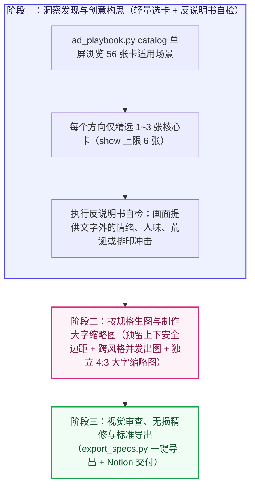

# 第二阶段技能（广告创意与出图）完整架构与理论蓝图

本蓝图将广告心理学机制、视觉表达光谱、修辞格技巧与说服模型整理为按需取用的灵感卡片库，解放画面表现形态，确保画面独立提供文字之外的情绪与视觉增量。

---

## 一、整体架构：三阶段工作流

---

## 二、四大按需灵感库（共 56 张卡）

- **抓心心理机制库（`library/psychology_hooks.json`）**：涵盖具身体验与隐秘共鸣、温柔守护与心理减负、公平直觉与厌恶算计、自我实现与体面身份四个维度。
- **视觉叙事与构图技巧库（`library/visual_templates.json`）**：涵盖 5 类开放主画面载体（真实人物处境纪实、大胆排印态度海报、荒诞戏剧现场、社区原生视觉母语、日常器物物理状态）、Goldenberg 构图模板、Phillips 物理结构与意义运算矩阵、视觉截停抓手、视觉质感与色调技巧。
- **标题与文案修辞库（`library/headline_devices.json`）**：涵盖修辞格反转、修辞格形式、受众对话与利益召唤、场景叙事与同盟战线、量级反差与价值重构。
- **切入定位与破防说服库（`library/persuasion_tactics.json`）**：涵盖施瓦茨受众认知阶段切入定位、市场竞争成熟度与独特机制披露、高代价信号与违约自罚承诺、瑕疵效应与双面说服、精确数字效应、尊重过往选择与零羞耻感切换、非强迫自主表达、福格行为模型 `B = MAP`、点击前后首屏信息气味。

---

## 三、两大核心原则表

### 【原则表 A】画面创意与图文分工原则

| 编号 | 核心原则 | 设计要求 |
| :--- | :--- | :--- |
| **A1** | **单一主张原则（Single-Minded Proposition，单图单一焦点）** | 每条广告聚焦讲透单一核心痛点或利益主张；同一需求可按需构思一个或多个平行创意方向，多项独立产品优势拆分为各自独立的广告。 |
| **A2** | **画面独立增量（拒绝把文案画成说明书）** | 画面独立提供文字之外的情绪张力、人的真实处境、荒诞反差、故事瞬间或纯粹视觉冲击；避免把标题已经写明的规则再原样画成进度条、红绿流程图或贴标签道具。图内文字随画面气质自由取舍、简短有力。 |
| **A3** | **外标题、画面与图内短句各司其职** | Reddit 帖子外标题、画面主体与图内文字彼此互补推进，避免同一句话重复三遍。 |
| **A4** | **利益落点清晰，复杂细则归入落地页** | 整条广告（外标题配合图片）让受众一眼明白与自身的关系及核心收益；表现形式完全开放，无需每张图强行拆成痛点与解药各占一半。统计口径与详细条款统一归入落地页。 |
| **A5** | **社区同伴感与鲜活审美** | 平视受众智商，顺应目标社区气质自由发挥，保持松弛自信与懂行巧思。 |
| **A6** | **点击前后 `B = MAP` 链路连贯** | 动机激发、低门槛消除顾虑与点击后落地页首屏验证在整条链路中顺畅衔接；低门槛接入信息可灵活放在外标题、落地页首屏或图内。 |

### 【原则表 B】Reddit 规格与生图精修原则

| 编号 | 核心原则 | 具体规范与执行要求 |
| :--- | :--- | :--- |
| **B1** | **Reddit 信息流主图比例与安全留白** | 默认采用官方推荐 **`4:5` 竖图（`1080 × 1350 px`）**，宽幅场景可采用 **`4:3` 横图（`1440 × 1080 px`）**，紧凑单焦点可采用 **`1:1` 方图（`1080 × 1080 px`）**。从原生 `3:4` 竖图转 `4:5` 时预留上下各约 `10%–12%` 纯背景安全边距，通过 `scripts/export_specs.py` 一键导出。 |
| **B2** | **独立生成 `4:3` 大字版缩略图** | **规格**：**`4:3`（`400 × 300 px`，文件体积 $\le 500\text{ KB}$）**。专门生成放大单一焦点特写并搭配超大加粗核心短词的缩略图。 |
| **B3** | **API 生图提示词：锁定精确英文 + 放开视觉表现** | 逐字指定精炼英文文案；生图子智能体仅负责生成原始图，多个候选版在媒介形态与情绪氛围上真正拉开跨度。 |
| **B4** | **人物真实自然与软件环境地道还原** | 真人神态鲜活真实、光影具有生活呼吸感；软件界面贴合真实外观习惯。 |
| **B5** | **局部无损精修要求** | 局部修补时保持原图人物神态、光影与材质肌理一致，只修改目标局部。 |
