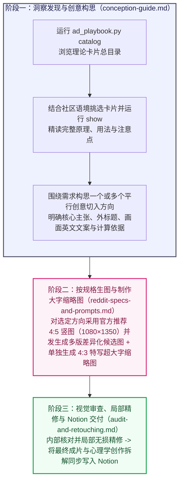

# Reddit 广告创意构思、按规格生图与无损精修

## 核心目标

承接社区研究阶段提炼的真实痛点与产品可兑现承诺，通过心理学抓心机制、社区原生视觉母语与具象实物转化、修辞反转以及高代价信号背书，产出能瞬间截停视线、卸下高认知用户防备并促成低门槛行动的 Reddit 广告主图与专用缩略图。

## 交付文档与表达要求

最终面向人阅读的交付文档同步写入目标 Notion 页面（通过可用 Notion 工具上传图片与写入内容；工具受限时通过浏览器技能完成），聚焦呈现以下两项内容：
1. **成品素材与标题**：最终广告主图、专用 `4:3` 缩略图与配套 Reddit 帖子外标题。
2. **心理学与创作拆解**：
   - **需求背景（一句话带过）**：用一句话简明交代针对的用户痛点与产品核心承诺。
   - **心理学机制与创作推导（核心重点）**：用通俗直白的话讲清这条广告调用了哪些心理学原理、视觉构图方法、标题修辞与破防说服技巧，以及整条广告是如何从核心承诺一步步构思成当前外标题、画面场景与图内文案的（画面包含具体数字时，顺带一句说明数字依据）。

生图提示词与双表质量核对在内部执行阶段完成。所有文字采用正向性叙事，减少二分叙事，降低排比与对比句式的比例，减少模型惯性。

---

## 三阶段工作流与按需路由



| 当前所处阶段 | 必读指南与脚本命令 | 阶段产出 |
| :--- | :--- | :--- |
| **阶段一：洞察发现与创意构思** | 阅读 [`references/conception-guide.md`](references/conception-guide.md)<br/>运行 `python3 scripts/ad_playbook.py catalog` / `show` | 一个或多个平行创意方向（含核心主张、心理学与说服构思、核实后的真实数字、帖子外标题与画面英文文案） |
| **阶段二：按规格生图与大字缩略图** | 阅读 [`references/reddit-specs-and-prompts.md`](references/reddit-specs-and-prompts.md) | 多张不同构图与媒介的主图候选版（官方首推 `4:5` 竖图 `1080 × 1350 px`，或 `4:3` 横图 `1440 × 1080 px` / `1:1` 方图 `1080 × 1080 px`）+ 独立重绘的 `4:3` 特写超大字缩略图 |
| **阶段三：视觉审查与 Notion 交付** | 阅读 [`references/audit-and-retouching.md`](references/audit-and-retouching.md) | 同步写入 Notion 的成品文档（含最终广告图、外标题，以及重点讲透心理学机制与创作构思过程的拆解说明） |

---

## 四大深层理论卡片库与检索脚本

本技能在 `library/` 目录下内置四个结构化 JSON 理论库，每张卡片均包含完整的**学术出处（`source`）**、**何时调用（`when_to_use`）**、**底层原理（`principle`）**、**画面用法（`visual_usage`）**、**文案用法（`copy_usage`）**与**误用注意点（`pitfalls`）**：

1. [`library/psychology_hooks.json`](library/psychology_hooks.json)：**抓心心理机制库**（痛点重现与自传体记忆唤醒、结果预演与虚拟所有权、感知被理解与隐秘日常微瞬间、圈内人暗号、良性失常幽默、禀赋偏爱守护、认知卸荷、峰终心流不中断、隐性漏损厌恶、心理账户死钱厌恶、免痛好奇心试错、自我决定理论、精明内行人体面感）。
2. [`library/visual_templates.json`](library/visual_templates.json)：**视觉叙事与构图技巧库**（社区原生视觉母语与情境现场推演、双重编码具象实物转化法、Goldenberg 经典获奖构图模板、Phillips 物理结构与意义运算矩阵、视觉截停抓手、视觉质感与动线技巧）。
3. [`library/headline_devices.json`](library/headline_devices.json)：**标题与文案修辞技巧库**（改写英语熟语、短句反义对仗、同音双关、拟人化因果反差、直接利益发问、第一人称温柔帮扶口吻、微瞬间点名、共同敌人同盟、微小动作与巨额代价反差、具象任务单位换算）。
4. [`library/persuasion_tactics.json`](library/persuasion_tactics.json)：**切入定位与破防说服技巧库**（施瓦茨受众认知阶段切入定位、市场竞争成熟度与独特机制披露、高代价信号与违约自罚承诺、瑕疵效应与双面说服、精确数字效应、零羞耻感切换、非强迫自主表达、福格行为模型 `B = MAP`、点击前后首屏信息气味）。

### 检索命令（`scripts/ad_playbook.py`）

```bash
# 1. 浏览全部理论与技巧卡片的紧凑菜单
python3 scripts/ad_playbook.py catalog

# 2. 按 ID 调取选中卡片的完整底层原理、画面用法、文案用法与注意点
python3 scripts/ad_playbook.py show <card_id_1> <card_id_2> ...
```

---

## 两大核心原则表

### 【原则表 A】画面认知与图文原则

| 编号 | 核心原则 | 设计要求 |
| :--- | :--- | :--- |
| **A1** | **单一主张原则（Single-Minded Proposition，单图单一焦点）** | 每张广告图内部聚焦讲透单一核心痛点或利益主张（通用规则与保障直接呈现普适价值，仅专属场景功能限定具体触发条件）；同一个用户需求或同一项产品承诺可构思一个或多个不同切入角度的平行创意方向（按需使用，无需每次强制生成多个），多项独立产品优势也拆分为各自的独立广告。 |
| **A2** | **视觉戏眼优先 + 零解码直觉 + 极简少字** | **视觉戏眼与极简度**：让画面本身的动作冲突、物理反差或幽默反转承担主要叙事（遮住辅助文字依然看得出关系与趣味），主标题短促点睛、一眼扫完，避免把长段说明硬印在静态载体上。<br/>**零解码直觉**：无论是原生界面、分格叙事、生活同构比喻还是物理道具，受众凭日常常识或社区直觉即可第一眼看懂因果关系。 |
| **A3** | **外标题与内图片互补（图文共鸣法则）** | Reddit 帖子外标题（Post Title）与图片内大字保持互补分工：外标题以社区同伴口吻发问、调侃或点出处境，图片内部直接给出视觉反转证据与核心承诺。 |
| **A4** | **痛点与解药同框，细则归入落地页（Whitman 法则）** | 图上出现的负面痛点在同框紧邻位置给出具体的解决方案与确定性数字；统计口径与详细条款统一放置在落地页。 |
| **A5** | **内行人懂梗共鸣与体面感** | 平视高认知受众智商，将成本优化与工具升级呈现为内行人的聪明掌控；既可用扎实数据实证，也可用内行冷幽默、形象比喻或违约赔付底气沟通，脱离廉价叫卖与刻板说教。 |
| **A6** | **点击前后 `B = MAP` 与首屏承诺一致** | 广告图上承诺的数字、机制与功能，在用户点进落地页首屏时第一眼即可看到对应的验证或操作入口。 |

### 【原则表 B】Reddit 规格与生图精修原则

| 编号 | 核心原则 | 具体规范与执行要求 |
| :--- | :--- | :--- |
| **B1** | **Reddit 信息流主图比例与满画幅构图** | 1. **主图标准比例**：**默认采用 Reddit 官方推荐的 `4:5` 竖图（`1080 × 1350 px`）**，在移动端占据最大信息流纵向空间；需要兼顾宽屏桌面端或左右宽幅版式时可采用 **`4:3` 横图（`1440 × 1080 px`）**，分格叙事图可采用 **`1:1` 方图（`1080 × 1080 px`）**。<br/>2. **满画幅原生场景**：主画面本身直接铺满画布或饱满撑起主体空间，四周留出干净呼吸边距，重要图文处于中央安全区域；多个候选版在媒介、色调与版式结构上拉开显著差异。 |
| **B2** | **独立生成 `4:3` 特写超大字缩略图** | **规格**：**`4:3` 横图（`400 × 300 px`，文件体积 $\le 500\text{ KB}$）**，服务于紧凑视图与 `old.reddit.com` 小尺寸预览。<br/>**做法**：截取放大主图最具冲击力的单焦点视觉特写，搭配撑满画幅核心区域的超大加粗短语与关键数字独立构图，确保在极小预览尺寸下依然第一眼看清图案与文字。 |
| **B3** | **API 生图提示词：指定英文文案 + 开放排版自由度 + 品牌小署名** | 1. **逐字指定画面英文文案（Verbatim Copy）**：在提示词中写清需要印在画面上的英文文案，全图仅渲染指定英文与真实核对数字。<br/>2. **开放构图自由度并发生成**：锁定核心视觉关系与文字内容，允许模型自由探索构图、字体与配色，并发生成多张不同构图方向的版本对比挑选。<br/>3. **品牌克制署名与真实 Logo**：文字品牌名在画面角落做克制小署名；需要展示真实品牌图形 Logo 或真实界面时，直接在 API 调用中传入官方参考图（Reference Image）。 |
| **B4** | **人物整洁度与社区真实界面还原** | 1. **真人形象**：人物气质贴合目标社区受众，面部与衣着干净整洁、采用自然环境光线。<br/>2. **软件界面还原**：画面中出现软件界面时，完整还原目标社区真实软件外观、排版习惯与正确品牌标识。 |
| **B5** | **局部无损精修要求** | 在执行局部修补与字号调整时，提示词明确锁定原图人物面部、光影方向与整体色温不变，保持自然柔和的原生光影与材质肌理。 |
