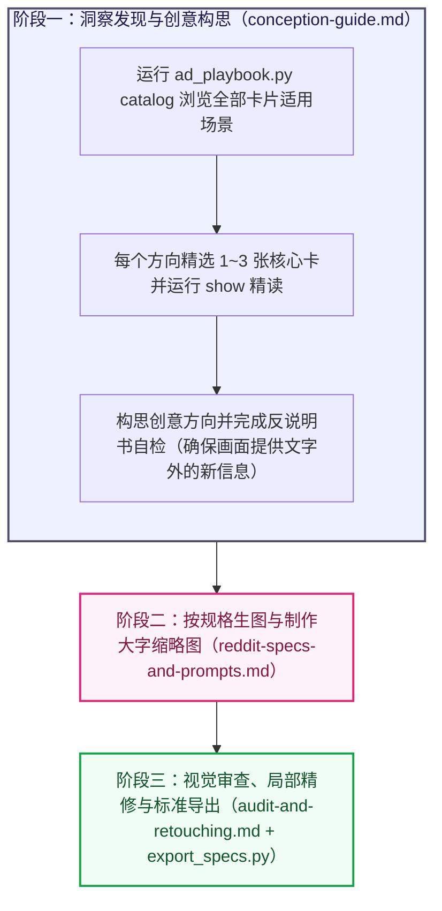

# Reddit 广告创意构思、按规格生图与无损精修

## 核心目标

承接社区研究阶段提炼的真实痛点与产品可兑现承诺，结合心理学共鸣、鲜活开放的视觉切入、标题修辞与可信背书，做出在 Reddit 信息流里让人停下视线、愿意主动了解的广告主图与 `4:3` 缩略图。

## 交付文档与表达要求

最终面向人阅读的交付文档同步写入目标 Notion 页面（通过可用 Notion 工具上传图片与写入内容；工具受限时通过浏览器技能完成），聚焦呈现以下两项内容：
1. **成品素材与标题**：最终广告主图、专用 `4:3` 缩略图与配套 Reddit 帖子外标题。
2. **心理学与创作拆解**：
   - **需求背景（一句话带过）**：用一句话简明交代针对的用户痛点与产品核心承诺。
   - **心理学机制与创作推导（核心重点）**：用通俗直白的话讲清这条广告调用了哪些心理学原理、视觉构图方法、标题修辞与破防说服技巧，以及整条广告是如何从核心承诺一步步构思成当前外标题、画面场景与图内文案的（画面包含具体数字时，顺带一句说明数字依据）。

生图提示词与双表质量核对在内部执行阶段完成。所有文字采用正向性叙事，减少二分叙事，降低排比与对比句式的比例，减少模型惯性。

---

## 三阶段工作流与按需路由



| 当前所处阶段 | 必读指南与脚本命令 | 阶段产出 |
| :--- | :--- | :--- |
| **阶段一：洞察发现与创意构思** | 阅读 [`references/conception-guide.md`](references/conception-guide.md)<br/>运行 `python3 scripts/ad_playbook.py catalog` / `show`（每方向精选 1～3 张卡） | 一个或多个平行创意方向（通过反说明书筛查，明确主张、帖子外标题、画面意境与精简图内文案） |
| **阶段二：按规格生图与大字缩略图** | 阅读 [`references/reddit-specs-and-prompts.md`](references/reddit-specs-and-prompts.md) | 多张不同媒介与构图的主图候选版（预留安全边距）+ 独立重绘的 `4:3` 特写超大字缩略图 |
| **阶段三：视觉审查、导出与 Notion 交付** | 阅读 [`references/audit-and-retouching.md`](references/audit-and-retouching.md)<br/>运行 `python3 scripts/export_specs.py` | 经标准规格导出（`1080 × 1350` 等）并同步写入 Notion 的成品文档（含最终广告图、外标题与心理学创作拆解） |

---

## 四大深层理论卡片库与检索脚本

本技能在 `library/` 目录下内置四个结构化 JSON 理论库，每张卡片均包含完整的**学术出处（`source`）**、**何时调用（`when_to_use`）**、**底层原理（`principle`）**、**画面用法（`visual_usage`）**、**文案用法（`copy_usage`）**与**误用注意点（`pitfalls`）**：

1. [`library/psychology_hooks.json`](library/psychology_hooks.json)：**抓心心理机制库**（痛点重现与自传体记忆唤醒、结果预演与虚拟所有权、感知被理解与隐秘日常微瞬间、圈内人暗号、良性失常幽默、禀赋偏爱守护、认知卸荷、峰终心流不中断、隐性漏损厌恶、心理账户死钱厌恶、免痛好奇心试错、自我决定理论、精明内行人体面感）。
2. [`library/visual_templates.json`](library/visual_templates.json)：**视觉叙事与构图技巧库**（真实人物情绪纪实、大胆排印态度海报、荒诞戏剧现场、社区原生视觉母语、日常器物物理状态、Goldenberg 获奖构图、Phillips 视觉修辞与截停质感技巧）。
3. [`library/headline_devices.json`](library/headline_devices.json)：**标题与文案修辞技巧库**（改写英语熟语、短句反义对仗、同音双关、拟人化因果反差、直接利益发问、第一人称温柔帮扶口吻、微瞬间点名、共同敌人同盟、微小动作与巨额代价反差、具象任务单位换算）。
4. [`library/persuasion_tactics.json`](library/persuasion_tactics.json)：**切入定位与破防说服技巧库**（施瓦茨受众认知阶段切入定位、市场竞争成熟度与独特机制披露、高代价信号与违约自罚承诺、瑕疵效应与双面说服、精确数字效应、零羞耻感切换、非强迫自主表达、福格行为模型 `B = MAP`、点击前后首屏信息气味）。

### 脚本命令（`scripts/`）

```bash
# 1. 单屏浏览全部理论卡片的名称与适用场景
python3 scripts/ad_playbook.py catalog

# 2. 按 ID 展开精选卡片（单次最多 6 张；每个方向精选 1~3 张核心卡即可）
python3 scripts/ad_playbook.py show <card_id_1> <card_id_2>

# 3. 将原始生图一键导出为精确 Reddit 官方尺寸 PNG（支持 feed-4x5 / feed-4x3 / feed-1x1 / thumb-4x3）
python3 scripts/export_specs.py <input.jpg> <output.png> --preset feed-4x5
```

---

## 两大核心原则表

### 【原则表 A】画面创意与图文分工原则

| 编号 | 核心原则 | 设计要求 |
| :--- | :--- | :--- |
| **A1** | **单一主张原则（Single-Minded Proposition，单图单一焦点）** | 每条广告聚焦讲透单一核心痛点或利益主张；同一需求可按需构思一个或多个不同切入角度的平行创意方向，多项独立产品优势拆分为各自独立的广告。 |
| **A2** | **画面独立增量（拒绝把文案画成说明书）** | 画面独立提供文字之外的情绪张力、人的真实处境、荒诞反差、故事瞬间或纯粹视觉冲击；避免把标题已经写明的规则再原样画成进度条、红绿流程图或贴标签道具。图内文字随画面气质自由取舍、简短有力，脱离“顶标题 + 中图示 + 底参数条”的固定宣传单套路。 |
| **A3** | **外标题、画面与图内短句各司其职** | Reddit 帖子外标题、画面主体与图内文字彼此互补推进：外标题以社区同伴口吻搭话、点出处境或抛问题，画面负责瞬间抓眼与情绪代入，图内短句给出反转态度或关键承诺，避免同一句话重复三遍。 |
| **A4** | **利益落点清晰，复杂细则归入落地页** | 整条广告（外标题配合图片）让受众一眼明白与自身的关系及核心收益；表现形式完全开放（单焦点人物瞬间、犀利大字海报、荒诞冷幽默或直观对比皆可），无需每张图强行拆成痛点与解药各占一半。统计口径与详细条款统一归入落地页。 |
| **A5** | **社区同伴感与鲜活审美** | 平视受众智商，顺应目标社区气质自由发挥（真人纪实、冷幽默玩梗、编辑级排印设计、生活抓拍或真实工作角落皆可），保持松弛自信与懂行巧思。 |
| **A6** | **点击前后 `B = MAP` 链路连贯** | 动机激发、低门槛消除顾虑与点击后落地页首屏验证在整条链路中顺畅衔接；低门槛接入信息可灵活放在外标题、落地页首屏或图内，无需在每张画面底部硬塞参数脚标。 |

### 【原则表 B】Reddit 规格与生图精修原则

| 编号 | 核心原则 | 具体规范与执行要求 |
| :--- | :--- | :--- |
| **B1** | **Reddit 信息流主图比例与安全留白** | 1. **主图标准比例**：默认采用 Reddit 官方推荐的 **`4:5` 竖图（`1080 × 1350 px`）**；宽幅场景可采用 **`4:3` 横图（`1440 × 1080 px`）**，分格或紧凑单焦点可采用 **`1:1` 方图（`1080 × 1080 px`）**。<br/>2. **满画幅构图与裁切安全边距**：主画面铺满画布，使用内置生图工具（原生输出 `3:4` 竖图 `896 × 1200 px`）转 `4:5` 时，提示词预留上下各约 `10%–12%` 纯背景延展呼吸空间，确保通过 `scripts/export_specs.py` 导出时文字与主体从容落在安全区内。 |
| **B2** | **独立生成 `4:3` 特写超大字缩略图** | **规格**：**`4:3` 横图（`400 × 300 px`，文件体积 $\le 500\text{ KB}$）**，服务于紧凑视图与 `old.reddit.com` 小尺寸预览。<br/>**做法**：放大最具冲击力的单一视觉焦点，搭配撑满画幅核心区域的超大加粗短词与关键数字独立生成，并通过 `scripts/export_specs.py --preset thumb-4x3` 导出。 |
| **B3** | **API 生图提示词：锁定精确英文 + 放开视觉表现** | 1. **逐字指定图内英文（Verbatim Copy）**：仅在提示词中列出真正需要印在图上的精炼英文与核实数字。<br/>2. **放开风格与构图探索**：调用生图子智能体时只传画面提示词与简短英文图片名（无需指定外部保存路径或 PNG 格式）；多个候选版在媒介形态、视角与氛围上真正拉开跨度。<br/>3. **克制署名与真实素材传入**：品牌名按画面风格自然融入角落或留白；需展示真实图形 Logo 或真实界面时直接传入官方参考图。 |
| **B4** | **人物真实自然与软件环境地道还原** | 1. **真人形象**：人物神态鲜活真实、衣着干净自然、光影具有纪实生活质感。<br/>2. **软件环境**：涉及软件界面时，符合目标社区日常真实软件的外观习惯与细节。 |
| **B5** | **局部无损精修要求** | 执行局部文字或细节修补时，提示词明确保持原图人物神态、光影方向与材质肌理一致，只修改目标局部。 |
