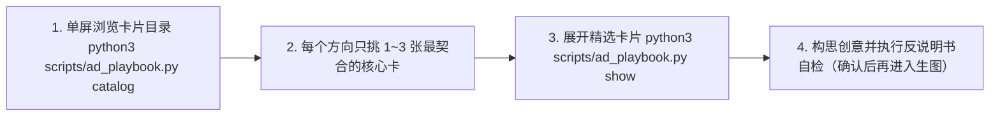

# 阶段一：洞察发现与创意构思指南（Discovery & Creative Conception）

阶段一的目标是将社区真实痛点与产品核心利益，转化为鲜活、有记忆点的广告切入方向。方向已经明确时，直接按单一方向进入生图；需要横向比较时，可并行给出不同情绪抓手与画面形态的方向供挑选。面向人阅读的最终交付重点讲清广告运用了哪些心理学原理、视觉与修辞思路，以及整条创意是如何一步步想出来的（需求来源一句话带过即可），全程采用正向性叙事，减少二分叙事，降低排比与对比句式的比例，减少模型惯性。

---

## 一、轻量选卡与构思流程



### 第 1 步：单屏浏览技巧库目录（名称 + `when_to_use` 适用场景）
运行以下命令浏览全部卡片的紧凑目录：
```bash
python3 scripts/ad_playbook.py catalog
```

### 第 2 步：克制精选 1～3 张核心卡（切忌凑齐所有分类）
四大技巧库是**按需取用的灵感菜单**：
- **抓心心理机制 (`psychology_hooks`)**：用哪种真实情绪或心理动机打动人？
- **视觉叙事与构图 (`visual_templates`)**：用哪种媒介形态（人物情绪纪实、大胆排印海报、荒诞戏剧现场、原生界面局部、生活器物等）或构图视角抓人眼球？
- **标题与文案修辞 (`headline_devices`)**：外标题或图内短句怎么开口更有味？
- **切入定位与破防说服 (`persuasion_tactics`)**：如何亮出底牌、消除试错顾虑并与落地页承接？

**选卡上限要求**：每个创意方向**只挑 1～3 张最能擦出火花的卡片**作为支点（`ad_playbook.py show` 单次最多允许展开 6 张卡）。同时套用过多卡片会把创意磨平成四平八稳的模板图。

### 第 3 步：精读选中卡片并放开构思
```bash
python3 scripts/ad_playbook.py show <card_id_1> <card_id_2>
```
阅读卡片底层原理时，取其神韵，让创意顺着具体产品与目标社区的真实语境自由生长。

### 第 4 步：生图前的「反说明书自检」（必过关卡）
启动生图前，对每个构思逐条自检，不通过则当场推翻重想：
1. **画面有没有提供文字之外的新信息？**
   - 如果标题已经写清了规则或数字，画面又用进度条、红绿箭头流程图、盖章单据或贴着英文解释标签的容器把同一句话再画一遍，这就是呆板的“文案说明书配图”——立刻淘汰，换成真实人物反应、荒诞生活瞬间、意外视角或干脆纯粹的大胆排印设计。
2. **遮住物体表面硬贴的标签，画面本身立得住吗？**
   - 画面里的情绪、冲突或幽默应当靠场景本身的气质、人的神态或物体的自然状态传递，摆脱靠贴满解释性小字才能看懂的道具图。
3. **与真人协作时先确认点子再出图**：
   - 在交互式对话中，先用几句大白话把构思好的外标题、画面意境与图内短句报给用户挑中，再调用生图工具并发出图，省去在平庸方向上空跑大图的时间。

---

## 二、构思阶段的灵活设计原则

### 1. 单一主张聚焦（原则 A1）
- 每条广告只讲透一个最打动人的核心点；有多项独立卖点时，拆成各自独立的广告分别发力。

### 2. 外标题、画面与图内短句互补推进（原则 A3）
- **Reddit 帖子外标题（Post Title）**：像社区里的同行同伴一样自然开口（抛一个扎心问题、点破心照不宣的瞬间或自嘲调侃）。
- **画面主体（Visual）**：承担第一眼的注意力截停与情绪共鸣，提供文字没直接写出来的现场感或反差。
- **图内文字（In-Image Copy）**：按画面风格自然取舍，简短点题或亮出核心承诺，摒弃千篇一律的“顶标题 + 中图示 + 底参数脚标”固定排版。

### 3. 利益清晰，解放构图形式（原则 A4）
- 只要受众看完外标题加图片能瞬间明白“这跟我的痛点有什么关系、能帮我解决什么”，画面采用单焦点特写、人物抓拍、荒诞冷幽默、纯大字态度或新旧对比全都成立，无需把每张图硬切成“痛点一半、解药一半”。复杂计算口径统一留给落地页。

### 4. 全链路 `B = MAP` 与首屏呼应（原则 A6）
- 动机（`Motivation`）、低门槛（`Ability`）与行动触发（`Prompt`）由外标题、画面和落地页首屏共同配合完成：低门槛接入方式既可自然带在外标题里，也可放在落地页首屏承接，让主图保持干净利落。
