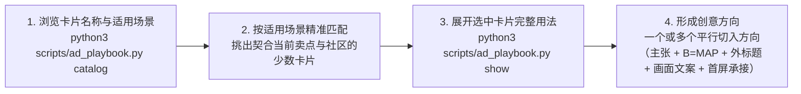

# 阶段一：洞察发现与创意构思指南（Discovery & Creative Conception）

在真实广告创作中，心理洞察、画面叙事、标题修辞与防备破除彼此咬合、同时激发。阶段一的目标是将社区真实痛点与产品核心利益，转化为一个或多个平行的创意切入方向。需要横向挑选时，可针对同一需求并行给出多个不同痛点瞬间、情绪抓手与画面载体的方案供选择；方向已明确时，直接按单一方向进入生图。最终面向人交付的文档重点讲清这条广告运用了哪些心理学原理与修辞/视觉/说服方法、是如何一步步创作出来的（需求来源用一句话带过即可），并采用正向性叙事，减少二分叙事，降低排比与对比句式的比例，减少模型惯性。

---

## 一、联动构思流程



### 第 1 步：读取四大技巧库目录（名称 + `when_to_use` 适用场景）
运行以下命令，按卡片名称与 `when_to_use`（适用场景）快速筛选契合本次任务的卡片，无需盲目展开无关卡片：
```bash
python3 scripts/ad_playbook.py catalog
```

### 第 2 步：跨库联动挑选卡片组合
根据目标 Subreddit（子社区）的社区文化、受众当前的认知阶段以及待表达的需求与承诺，从四个技巧库中按需挑选彼此互补的卡片组合。若针对同一需求并行构思多个切入方向，每个方向各自搭配一组互补卡片：

| 技巧库 | 选卡目标 | 核心职责 |
| :--- | :--- | :--- |
| **抓心心理机制 (`psychology_hooks`)** | 选定驱动本条广告的核心情绪抓手 | 决定用哪种深层情绪动机打动受众。 |
| **视觉叙事与构图 (`visual_templates`)** | 选定主画面载体、构图结构与截停抓手 | 决定主画面载体、构图模板（Goldenberg 构图模板）、物理结构与意义运算（Phillips 矩阵）以及视觉截停方式。 |
| **标题与文案修辞 (`headline_devices`)** | 选定外标题与画面主文案的修辞招式 | 决定帖子外标题与图片内大字采用哪种修辞招式。 |
| **切入定位与破防说服 (`persuasion_tactics`)** | 选定开口切入层、背书方式与转化承接 | 决定从哪一层认知开口（施瓦茨认知阶段）、如何亮出独特机制与高代价违约赔付承诺、如何遵循双面说服顺序，以及如何配齐 `B = MAP` 与落地页首屏承接。 |

### 第 3 步：调取选中卡片的完整原理、用法与注意点
选定候选卡片 ID 后，运行 `show` 子命令阅读其完整字段（`principle`、`visual_usage`、`copy_usage` 与 `pitfalls`）：
```bash
python3 scripts/ad_playbook.py show <card_id_1> <card_id_2> ...
```
查看卡片底部的 `pairs_with` 推荐列表，确认所选的心理机制、视觉载体与文案修辞在底层逻辑上相互强化。敲定构思前完成**视觉戏眼自检**：将抽象规则转化为带动作冲突、物理反差或幽默反转的画面关系，确保遮住辅助说明文字后，单看画面主体与核心数字依然看得出冲突或趣味点。

---

## 二、构思阶段的核心设计要求

### 1. 单一主张原则（Single-Minded Proposition，单图单一焦点 — 原则 A1）
- **单图聚焦**：每一张广告图内部聚焦讲透**单一核心痛点或利益主张**；通用规则与保障直接呈现普适价值，避免强行附加狭窄的前置报错条件。
- **同一需求可对应一个或多个创意方向**：针对同一个用户需求或同一项产品承诺，既可以直接确立一个创意方向进入生图，也可以从不同的日常痛点微瞬间、心理抓手与视觉载体出发，并行构思多个独立创意方向供挑选。
- **多项卖点拆分**：当产品同时具备多项独立优势时，同样拆分成各自独立的广告方向。

### 2. 外标题与图片内大字互补（图文共鸣法则 — 原则 A3）
- **Reddit 帖子外标题（Post Title）**：扮演社区同伴交流或直接发问的角色，负责交代具体处境或提出利益诊断问题。
- **图片内主文案（In-Image Copy）**：保持短促有力、一眼扫完，直接给出视觉反差的结论、修辞反转或核心承诺，与外标题形成信息互补。

### 3. 痛点与解药同框，细则归入落地页（Whitman 法则 — 原则 A4）
- 画面中出现的负面痛点，在同一画框内紧跟具体的解决方案与确定性数字。
- 复杂的统计口径与详细条款统一放进落地页，保持广告画面干净明快。

### 4. 福格行为模型 `B = MAP` 转化设计
构思每条广告时，明确规划：
- **Motivation（动机）**：靠哪项心理机制激发痛感逃离或拥有渴望？
- **Ability（极低门槛）**：如何在图上直接呈现极低的第一步接入或试用成本？
- **Prompt（触发提示）**：外标题与画面视觉动线如何自然引导受众点击查看验证？

### 5. 点击前后认知连贯性（Message Match — 原则 A6）
- 受众因广告图上的某个具体数字、对比项或赔付承诺而点击，点进落地页首屏时第一眼即可看到完全对应的验证入口或交互工具。
