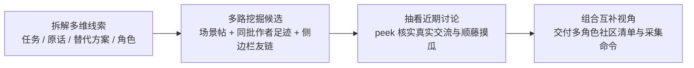

# 按场景发现合理的 Reddit 社区

围绕一个具体业务场景、产品方向或用户问题，找出**真实讨论该场景、角色视角互补的合理社区组合（`r/...`）**，为下游 [`reddit-community-research`](../reddit-community-research/SKILL.md) 深度调研与 [`reddit-ad-launch`](../reddit-ad-launch/SKILL.md) 社区定向提供可靠起点。

## 流程概览



## 1. 从场景拆出多维检索线索

Reddit 社区名称往往按工具名、职业身份或圈内行话命名，很少直接对应抽象业务词。先明确本轮要找什么人在什么情况下做什么事，同时拆出以下维度的简短英文日常表达并行检索：

- **具体任务动作**：用户正在动手做的具体事情与操作环节。
- **求助与吐槽原话**：遇到阻碍时的口语提问、抱怨或求助表达。
- **现有工具与土办法**：用户在缺少理想方案时正在凑合使用的竞品、开源库、脚本或手工流程。
- **目标人群身份**：会在日常工作或使用中频繁遇到该场景的职业、角色或玩家群体。

如果用户同时给出了已知社区或竞品名，直接记入初始种子列表。

## 2. 多路挖掘与交叉收敛

结合“搜场景真帖”与“查同批作者常逛社区及侧边栏友链”收集候选名单，优先关注**在多组不同线索中重复浮现的交叉社区**。

### 路径 A：多组短语并行搜真实帖子，按反馈动态伸缩

通过已安装的 OpenCLI 或网页搜索并行检索多组场景短语，观察真实讨论自然落在哪些 `r/...`：

```bash
# 使用 OpenCLI 搜索 Reddit 真实帖子（需本地浏览器连接可用）
opencli reddit search "<场景短语>" --sort relevance --time year -f json

# 或使用网页搜索检索 r/ 讨论帖：site:reddit.com/r/ <场景短语>
```

根据命中反馈动态调整检索粒度：

- **命中过于稀少时放宽一层**：从过细的产品功能词往上一层退到所属工作流环节、父级品类或人群身份。
- **命中全是宽泛大社区时收窄一层**：叠加上具体的阻碍现象、报错感受或手工替代做法，筛出真正聊细节的垂直圈子。

从命中结果中同时收集直接命中的社区名（`subreddit`），以及确实在深入讨论该场景的普通用户（`author`，跳过官方号与机器人），交给路径 B 继续拓展。

### 路径 B：顺着真实作者近期足迹与种子侧边栏扩展关联社区

运行配套脚本 `scripts/community_discovery.py expand`（基于 Python 标准库与 Arctic Shift 公共归档接口），同时利用**多位目标作者近期共同活跃足迹**与**版主在侧边栏整理的关联社区友链**挖掘隐藏版块：

```bash
python3 scripts/community_discovery.py expand \
  --seed-subreddit <种子社区> \
  --author <作者名> \
  --prefix <词根前缀>
```

关键信号说明：

- `--seed-subreddit`：可重复传入已知种子社区；脚本会自动解析社区侧边栏（`sidebar_from`）中版主推荐的姊妹社区，并抽样近期真实发帖作者纳入统计。
- `--author`：可重复传入路径 A 找到的场景相关作者；脚本默认聚焦近期活跃窗口，统计多位目标作者共同聚集的其他社区（`matched_authors`），直接挖出名字不含业务词的高浓度垂直社区。
- `--prefix`：可重复传入简短英文词根，按社区名称前缀补充候选。

## 3. 快速核实候选社区的日常讨论

把汇总出的候选社区传入 `peek` 子命令，一次性拉取社区简介、实时订阅人数、侧边栏关联社区（`related_subreddits`）以及近期帖子标题、互动评论数与摘要：

```bash
python3 scripts/community_discovery.py peek \
  --subreddit <候选社区>
```

阅读 `peek` 返回的近期帖子与互动情况，完成合理性确认：

- **剔除同名异义版块**：仅凭社区名字或一句话简介极易误判缩写重名、无关游戏娱乐或同名代币炒作版块，必须以近期帖子的实际讨论内容为准。
- **区分真实交流与纯自荐灌水版块**：查看近期帖子的正文与评论互动（`num_comments`），优先保留有人认真提问、吐槽、拆解方案并产生真实回复互动的社区，避开只有单向发外链宣传、无人交流的推广版块。
- **顺手查漏侧边栏友链**：查看 `related_subreddits` 中版主列出的细分上下游社区，发现遗漏的高契合社区时一并纳入核实。
- **保留合理的规模梯度**：垂直工具与工作流小圈子讨论浓度高，大型综合社区适合观察大众认知与破圈阻力，搭配保留。

若某个综合社区最新帖子多为泛行业动态，可再用路径 A 检索 `site:reddit.com/r/<社区名> <场景短语>`，核实其中确实存在目标场景的具体讨论后再决定去留。

## 4. 组合互补视角并衔接下游

同一个业务场景在不同社区里呈现出截然不同的痛点侧面。围绕研究或投放目标，从核实通过的社区中挑出**角色与立场互补的合理社区组合**，避免全部选成同质化的单一品类社区：

| 社区切面 | 能回答什么问题 |
| --- | --- |
| **核心品类与竞品圈** | 已经在用同类方案的人最满意什么、最常吐槽什么、为什么切换 |
| **一线执行与日常工作流圈** | 每天实际干活的人在具体软件或流程里卡在哪个操作环节、浪费了多少精力 |
| **负责人与资源决策圈** | 承担成本与结果的负责人按什么标准算账、顾虑什么投入风险或维护负担 |
| **自建替代与上下游邻近圈** | 不信任现有成品而自己搭脚本表格硬扛的人，以及尚未接触本品类的潜在增量人群在怎样解决问题 |

### 交付格式

直接向用户呈现清晰的社区推荐清单（若任务指定了 Notion 页面，同步写入该页面）：

- **推荐社区组合表**：列出社区名称（附 `https://www.reddit.com/r/<name>/` 链接）、所属切面、订阅规模、该社区看待本场景的独特视角与日常讨论内容、入选理由，以及真实场景代表帖直达链接。
- **备选观察社区**（按需补充）：讨论量偏少或话题更宽泛、可按需扩充的社区及简短说明。
- **下游一键采集命令**：附上可直接交给 [`reddit-community-research`](../reddit-community-research/SKILL.md) 执行的多社区采集命令，方便确认名单后立即进入深度需求调研：

```bash
python3 skills/reddit-community-research/scripts/reddit_research.py collect \
  --db /绝对路径/research.sqlite \
  --subreddit <社区名称> \
  --after <开始日期> \
  --before <结束日期>
```
